## About this lecture

In the single-cell preprocessing unit you turned raw droplets into a clean matrix: **~2000 genes × thousands of cells**, QC-filtered and normalized. Today we turn that matrix into a **map of cells** — a picture you can actually look at, with cell groups marked on it.

- **Reduce & denoise first with PCA** — reuse the machinery from Principal component analysis and PCA in R.
- Build a **k-nearest-neighbour (kNN) graph**: who sits next to whom in gene-expression space.
- Lay the graph out in 2D with **UMAP** — a **non-linear** map that preserves *local* neighbourhoods (contrast the *linear* PCA).
- Find cell groups with **graph-based clustering** (Louvain / Leiden).
- **Caveats:** UMAP axes and distances are not quantitative, the resolution parameter changes how many clusters you get, and none of this is ground truth.

This is an **applied concept day**. The pipeline is short; the discipline is in reading the output honestly.

::: notes
The one-sentence framing: we are going from a matrix nobody can look at (thousands of genes, thousands of cells) to a two-dimensional map with coloured islands of cells. Emphasise that every step is something they have already met in pieces — PCA from the Applications block, distances and neighbours from vector geometry, graphs from the Markov-chain state diagrams. Today just assembles them into the standard single-cell workflow. Flag early and often that the payoff picture (the UMAP) is seductive and easy to over-read, and that half of today's learning outcome is knowing what NOT to conclude from it.
:::

## The biology: what is a cell type? {.smaller}

A tissue is a mixture of cell types — neurons, T cells, macrophages, fibroblasts — each running its **own programme** of active genes.

- Single-cell RNA-seq measures, for **every cell**, how much of each gene is expressed.
- Cells of the **same type** express **similar** sets of genes → they sit **close together** in gene-expression space.
- Cells of **different types** sit **far apart**.

The biological question is simple to state: **how many cell populations are in this sample, and which cells belong to which?**

We never told the computer the cell types. We want to **discover** them from the expression alone — this is **unsupervised** learning, exactly like PCA.

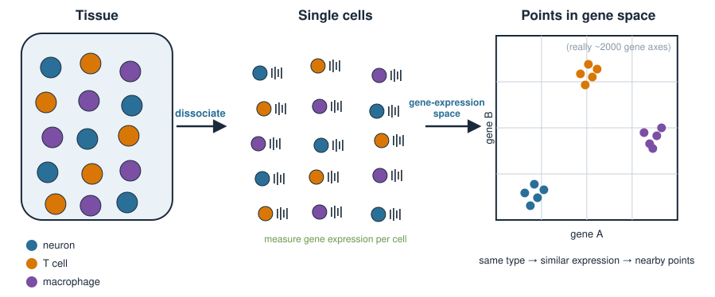{width="80%" fig-align="center"}

::: notes
Ground the whole lecture in one biological question before any method: given a dissociated tissue, find the cell populations and assign every cell to one. Stress the geometric intuition that "same cell type = similar expression = nearby point". This is the bridge between biology and the linear algebra: a cell is a point in a space whose axes are genes. Also plant the word unsupervised — we discover groups without labels, the same stance PCA took. Cell-type *naming* (matching clusters to known markers) is a separate later unit, cell-type annotation; today we only find the groups.
:::

## Each cell is a point in gene space {.smaller}

Stack the normalized data as a matrix: rows = cells, columns = genes.

$$
X = \begin{pmatrix}
x_{11} & x_{12} & \cdots & x_{1g} \\
x_{21} & x_{22} & \cdots & x_{2g} \\
\vdots & & \ddots & \vdots \\
x_{n1} & x_{n2} & \cdots & x_{ng}
\end{pmatrix}
\qquad
\begin{array}{l}
n \approx \text{thousands of cells} \\
g \approx \text{2000 genes}
\end{array}
$$

- Row $i$ is one cell: a point in a **$g$-dimensional** space (one axis per gene).
- "Similar cells" = points whose rows are close, e.g. small **Euclidean distance** $\lVert \mathbf{x}_i - \mathbf{x}_j \rVert$.

We cannot plot a 2000-dimensional space. We need to **compress** it to 2D **without destroying** the neighbourhood structure. That is the whole problem.

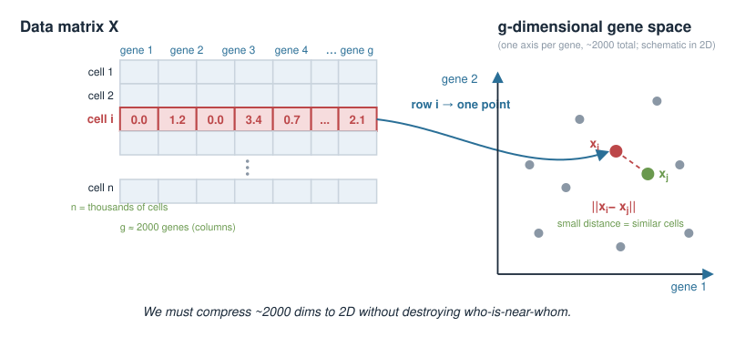{width="70%" fig-align="center"}

::: notes
Make the matrix concrete and connect to the sample × feature matrices they already know from the statistics course — here samples are cells and features are (highly variable) genes. Emphasise that after preprocessing we usually keep only the ~2000 highly variable genes, not all 20000, because most genes are uninformative noise. Restate the geometric definition of similarity as small distance, which they met in vector geometry. Then state the crux: 2000 dimensions is unplottable and also noisy, so we must reduce — and the reduction must protect who-is-near-whom.
:::

## The pipeline in one picture {.smaller}

$$
\underbrace{X}_{\text{cells × genes}}
\;\xrightarrow{\;\text{PCA}\;}\;
\underbrace{Z}_{\text{cells × }\sim 30\text{ PCs}}
\;\xrightarrow{\;\text{kNN}\;}\;
\underbrace{G}_{\text{neighbour graph}}
\;\xrightarrow{\;\begin{array}{c}\text{UMAP}\\\text{clustering}\end{array}\;}\;
\underbrace{\text{2D map + cluster labels}}_{\text{what you look at}}
$$

| Step | What it does | Why |
|---|---|---|
| **PCA** | 2000 genes → ~30 components | denoise, speed up, remove redundancy |
| **kNN graph** | connect each cell to its nearest neighbours | capture *local* structure |
| **UMAP** | graph → 2D coordinates | a picture you can plot |
| **Clustering** | cut the graph into communities | name the cell groups |

Notice: **UMAP and clustering both run on the same kNN graph.** They are two views of one neighbourhood structure.

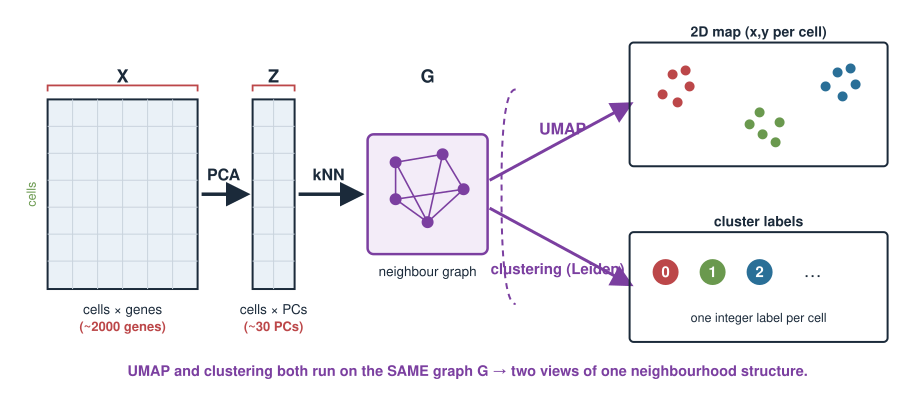{width="75%" fig-align="center"}

::: notes
This is the roadmap slide — return to it between steps. The key conceptual point students miss: UMAP (the picture) and clustering (the groups) are computed independently from the same graph, so clusters are not "found in the UMAP" — both are downstream of the neighbour graph. That is why a cluster can occasionally look split or mixed in the UMAP: the 2D layout and the community detection are different algorithms fed the same input. Also note PCA does double duty: denoising AND making the downstream distance computations fast and meaningful (fewer, less noisy dimensions).
:::

## Step 1: PCA to denoise and reduce {.smaller}

Before anything else, run PCA on the (scaled) cell × gene matrix — the exact method from Principal component analysis and PCA in R.

- The first ~30–50 **principal components** capture the **coordinated** variation across genes (real biology: shared expression programmes).
- The discarded components are dominated by **technical noise** and gene-by-gene sampling scatter.
- We keep the **top PCs** and work in that space from now on: `cells × 30`, not `cells × 2000`.

Why this matters for what follows:

- **Distances are more meaningful** in ~30 denoised dimensions than in 2000 noisy ones.
- Everything downstream (kNN, UMAP, clustering) is **faster and more stable**.

Choosing *how many* PCs is the **elbow / scree** decision from Choosing components & pitfalls.

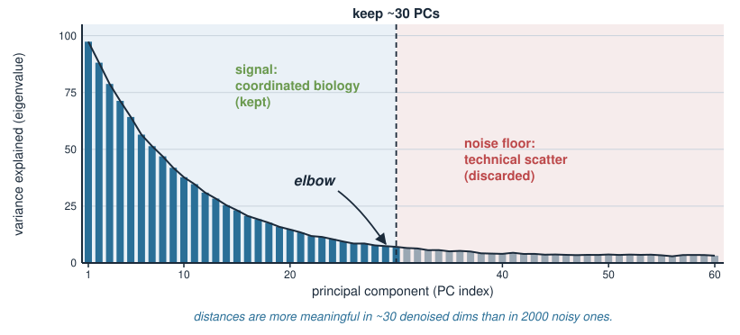{width="60%" fig-align="center"}

::: notes
Reassure students that Step 1 is not new — it is the PCA they already built from the eigen-decomposition of a covariance matrix, applied to cells × genes. The single new idea is the *reason*: PCA here is a denoising and compression pre-step, not the final visualization. Counts are noisy and high-dimensional; distances computed directly in 2000-gene space are swamped by noise (a mild "curse of dimensionality" point). Reducing to ~30 PCs concentrates the signal. The number of PCs is a real choice with the same scree/elbow tools from the pitfalls unit; 30 is a common default, not a law.
:::

## Why PCA alone is not the picture {.smaller}

PCA already gives coordinates — why not just plot PC1 vs PC2?

- PCA is **linear**: every PC is a straight-line (weighted-sum) combination of genes. PC1 vs PC2 shows only the **two directions of greatest variance**.
- Real cell populations lie on **curved, branched** structures (differentiation trajectories, discrete islands). A linear projection **flattens** them — distinct types overlap.
- The top 2 PCs capture a lot of variance but usually **not** the fine local separation between similar cell types.

We used ~30 PCs precisely because 2 are not enough. But we can only *plot* 2 dimensions.

**Need:** a map that uses all 30 PCs' worth of neighbourhood information but draws it in 2D, and is allowed to **bend**. That is a **non-linear** embedding — UMAP.

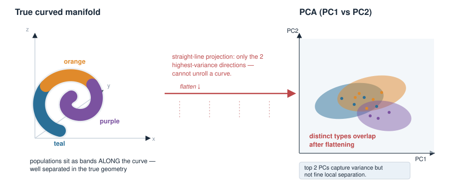{width="60%" fig-align="center"}

::: notes
This is the linear-vs-non-linear pivot, and it echoes the "PCA only sees linear structure" pitfall from Choosing components & pitfalls. Make the contrast sharp: PCA is a rigid rotation of the axes — a straight-line projection — so it can only show the two highest-variance directions and it cannot unfold a curved manifold. Cell states often sit on curved or branched manifolds, and similar-but-distinct types get smeared together in PC1/PC2. UMAP is permitted to distort distances non-linearly, which is exactly what lets it pull apart local neighbourhoods that PCA overlaps. Preview honestly: that same freedom to distort is why UMAP distances stop being quantitative.
:::

## Step 2: the k-nearest-neighbour graph {.smaller}

Work in the ~30-PC space. For each cell, find its **$k$ nearest neighbours** (typical $k \approx 15$) by Euclidean distance, and draw an **edge** to each.

$$
\text{dist}(\mathbf{x}_i, \mathbf{x}_j) = \lVert \mathbf{x}_i - \mathbf{x}_j \rVert = \sqrt{\sum_{p=1}^{30} (x_{ip} - x_{jp})^2}
$$

- The result is a **graph** $G$: nodes = cells, edges = "is a near neighbour of".
- It records only **local** relationships — who is close to whom — and throws away exact long-range distances.
- Densely connected clumps of cells = candidate cell populations.

This graph is the shared input to **both** UMAP and clustering.

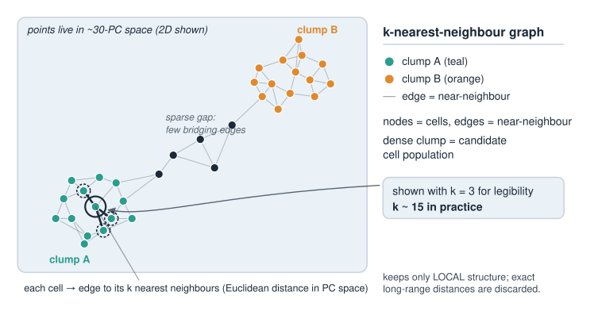{width="60%" fig-align="center"}

::: notes
Define the kNN graph concretely: pick k (default around 15), connect each cell to its k closest cells in PC space. The distance is the ordinary Euclidean norm from vector geometry, just in 30 dimensions. Two teaching points: (1) the graph keeps only local structure — it deliberately forgets that two far-apart clusters are "very" far vs "extremely" far, which is why global distances later become meaningless; (2) this is the same object as a Markov-chain state diagram — nodes and weighted edges — so the graph idea is not new. Cells in a dense region get a tightly interconnected subgraph, which is what clustering will later carve out.
:::

## Step 3: UMAP lays the graph out in 2D {.smaller}

**UMAP** = *Uniform Manifold Approximation and Projection*. Input: the kNN graph. Output: an $(x, y)$ coordinate for every cell.

The idea (no formulas today):

- Assume the cells lie on a smooth low-dimensional **manifold** curled up inside gene space.
- Find 2D coordinates so that cells that are **neighbours in the graph** stay **close** in the plot, and non-neighbours are pushed apart.
- It is **non-linear**: it may **stretch and bend** the space differently in different regions to make local neighbourhoods fit on a flat page.

The result: tight **islands** of similar cells, visibly separated — the canonical single-cell figure.

**t-SNE** is an older method with the same goal; UMAP is faster and is now the default. Neither is "more correct" — both are visualization tools.

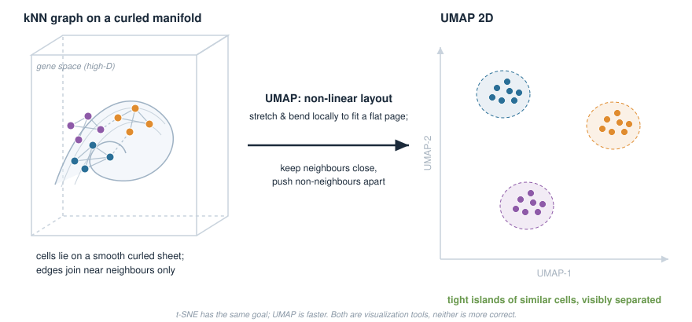{width="70%" fig-align="center"}

::: notes
Keep UMAP at the intuition level — the manifold assumption plus "preserve local neighbours, separate the rest." Do not attempt the fuzzy-simplicial-set / cross-entropy math; it is beyond this course and not examined. The load-bearing word is non-linear: UMAP is allowed to warp the space region by region, unlike PCA's single global rotation, and that warping is what produces clean separated islands. Mention t-SNE so students recognise it in papers, but frame both as visualization aids, not measurements. Set up the next slide: the price of that warping is that the axes and inter-island gaps carry no quantitative meaning.
:::

## UMAP vs PCA: two different jobs {.smaller}

| | **PCA** | **UMAP** |
|---|---|---|
| Mapping | **linear** (rotation / projection) | **non-linear** (bends locally) |
| Preserves | global variance directions | **local** neighbourhoods |
| Axes mean | variance (PC1 = most variance) | **nothing** interpretable |
| Distances | meaningful (in PC space) | **not** quantitative |
| Reversible | yes (loadings map back to genes) | no |
| Used here for | **denoising / reduction** | **visualization only** |

They are **complementary**, not competitors: we run PCA **then** UMAP. PCA cleans and compresses; UMAP draws.

::: notes
This table is the conceptual anchor of the lecture — worth pausing on. The single biggest misconception to kill: that UMAP "replaces" or "improves on" PCA. They do different jobs and we use both in sequence. PCA's axes and distances are interpretable (a PC is a weighted sum of genes; distance in PC space is real); UMAP's are not (the axes are unlabelled and the gaps between islands are not to scale). PCA is invertible via loadings back to genes; UMAP is a one-way picture. Have students copy this table — several exam-style conceptual questions come straight from it.
:::

## Reading a UMAP honestly {.smaller}

What you **may** read off a UMAP:

- Cells that fall in the **same tight island** are similar to each other. ✔
- The presence of **several distinct islands** suggests several cell populations. ✔

What you **may not** read off a UMAP:

- The **distance between two islands** is *not* how different those populations are. ✘
- The **size/spread** of an island is *not* how variable or abundant that population is. ✘
- The **axes** (UMAP-1, UMAP-2) mean **nothing** — do not report values. ✘
- **Rotations / flips** are arbitrary; re-running with a new seed gives a different-looking (but equivalent) picture. ✘

Rule of thumb: **local = trustworthy, global = decorative.**

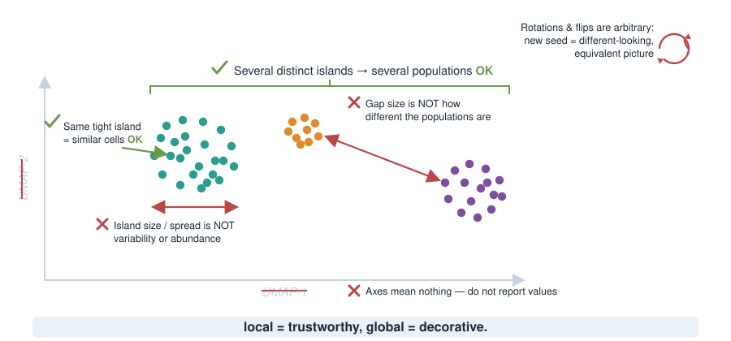{width="55%" fig-align="center"}

::: notes
Devote real time here — this is the discipline half of the lecture. Walk each forbidden reading: inter-cluster gaps are meaningless (a huge gap can separate near-identical states and a small gap can separate very different ones), island area reflects the algorithm's crowding control, not biological variance or cell count, and the axes are unnamed by construction. Stress reproducibility: UMAP depends on a random seed and on parameters, so the exact shape is not stable — only the local grouping is. Give them the mantra "local trustworthy, global decorative." Tell them reviewers and examiners specifically look for over-read UMAPs.
:::

## Step 4: graph-based clustering {.smaller}

To *name* the cell groups we cut the **same kNN graph** into **communities** — sets of cells more densely connected to each other than to the rest.

- **Louvain** and **Leiden** are **community-detection** algorithms: they group nodes to maximize a **modularity**-style score (more within-group edges than expected by chance).
- **Leiden** is a refinement of **Louvain** that guarantees the communities are internally well-connected; it is now the default.
- Each community becomes a **cluster** = a candidate cell population, given an arbitrary label (0, 1, 2, …).

Crucially: clustering runs on the **graph**, *not* on the UMAP coordinates. The UMAP is only how we **display** the clusters, by colouring each cell.

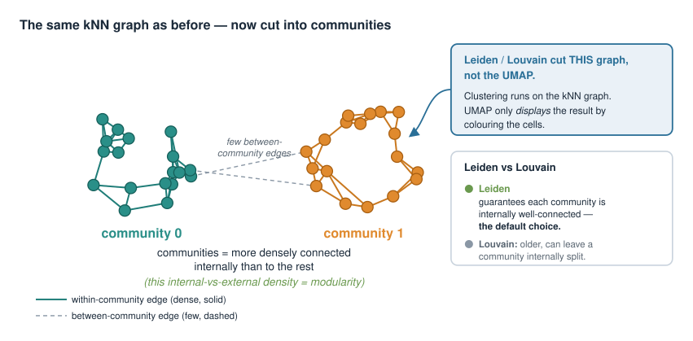{width="60%" fig-align="center"}

::: notes
Define clustering as community detection on the neighbour graph: partition the nodes so edges fall mostly within groups. Modularity is the score being optimized — within-community edge density above a random baseline; no need to write the formula. Emphasise Leiden over Louvain (Leiden fixes a known Louvain flaw where communities could be internally disconnected). The recurring point, stated a third time deliberately: clusters come from the graph, the UMAP is only a canvas to paint them on. That decoupling is why you sometimes see one colour split across the UMAP or two colours touching — the layout and the partition are separate computations.
:::

## The resolution parameter {.smaller}

Community detection has a knob: **resolution**. It sets how fine-grained the partition is.

- **Low** resolution → **fewer, larger** clusters (lumps related types together).
- **High** resolution → **more, smaller** clusters (splits fine subtypes — and eventually splits noise).

$$
\text{resolution} \uparrow \quad\Longrightarrow\quad \text{number of clusters} \uparrow
$$

There is **no single correct value** and **no true number of clusters**. The "right" resolution depends on the biological question — do you want *T cells*, or *CD4 vs CD8 vs regulatory T cells*?

Good practice: try a **range** of resolutions, and judge clusters by **known marker genes**, not by which value looks tidiest.

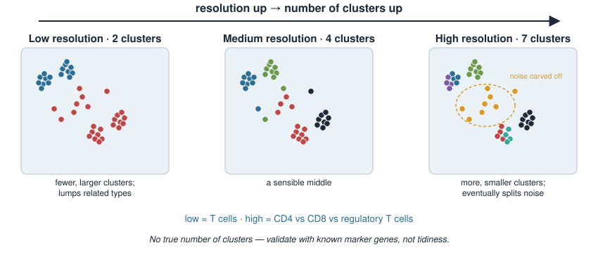{width="75%" fig-align="center"}

::: notes
Resolution is the parameter students most need to respect. Make the monotone relationship explicit: turn it up, get more clusters; turn it down, get fewer. Then the hard truth — there is no ground-truth cluster count; the biologically correct granularity depends entirely on the question. Over-clustering manufactures "cell types" that are really noise; under-clustering merges real distinct populations. The disciplined workflow is to scan several resolutions and validate with known marker genes (previewing the cell-type annotation unit), rather than trusting the number that produces the prettiest picture. This is a favourite exam-discussion point.
:::

## The whole workflow in R (Seurat) {.smaller}

Assume `seu` is the QC-ed, normalized object from the preprocessing unit.

```r
library(Seurat)

# 1. Scale, then PCA (denoise + reduce): reuse the PCA machinery
seu <- ScaleData(seu)
seu <- RunPCA(seu, npcs = 50)
ElbowPlot(seu)                       # scree/elbow: how many PCs to keep?

# 2. kNN graph on the top 30 PCs (Euclidean distance in PC space)
seu <- FindNeighbors(seu, dims = 1:30, k.param = 15)

# 3. Graph-based clustering (Leiden/Louvain) at a chosen resolution
seu <- FindClusters(seu, resolution = 0.5)

# 4. UMAP layout from the SAME 30 PCs, for display only
seu <- RunUMAP(seu, dims = 1:30)

# 5. Plot: UMAP coloured by cluster label
DimPlot(seu, reduction = "umap", label = TRUE)
```

Five function calls map exactly onto the four pipeline steps. No package is installed here — read this as a recipe, not runnable code.

::: notes
Walk the code as a one-to-one map onto the roadmap: ScaleData + RunPCA is Step 1, FindNeighbors is Step 2 (the kNN graph, note dims = 1:30 selects the top PCs and k.param sets k), FindClusters is Step 4 (resolution is the knob from the previous slide), RunUMAP is Step 3 for display. Point out the load-bearing detail that FindNeighbors and RunUMAP both take dims = 1:30 — same PC input, two outputs. FindClusters uses the graph FindNeighbors built, not the UMAP. This is static illustration code; nothing runs at render time. Mention scanpy's sc.pp.neighbors / sc.tl.leiden / sc.tl.umap are the exact same steps for Python users.
:::

## Peeking under the hood: kNN by hand in R {.smaller}

The Seurat calls are black boxes. Here is the kNN step on a **toy** PC matrix, in base R, so you can see there is no magic.

```r
# six cells, each already reduced to 2 PCs
Z <- rbind(
  A = c(0, 0), B = c(1, 0), C = c(0, 1),   # group 1 (near origin)
  D = c(5, 5), E = c(6, 5), F = c(5, 6))    # group 2 (near (5,5))

D2 <- as.matrix(dist(Z))     # all pairwise Euclidean distances
round(D2, 2)

# the 2 nearest neighbours of each cell (column 1 is the cell itself)
apply(D2, 1, function(col) names(sort(col))[2:3])
```

Each cell's two nearest neighbours are the **other two members of its own group** — the graph splits cleanly into two communities. That is clustering in miniature.

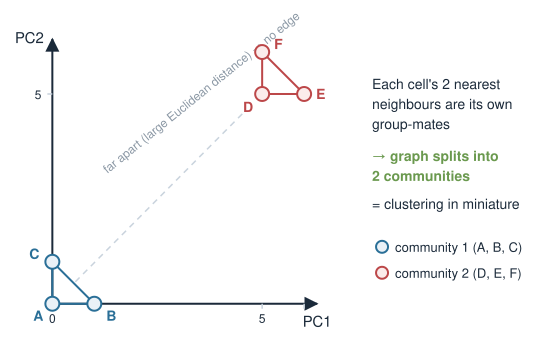{width="50%" fig-align="center"}

::: notes
Demystify the pipeline by doing the neighbour step with dist() and sort() on six points — no special package. Students see that "kNN graph" is literally: compute Euclidean distances, take the k smallest per row. The toy coordinates are chosen so the two groups are obvious, and each cell's nearest neighbours are its own group-mates, so the resulting graph has two disconnected pieces = two clusters. This is exactly the by-hand exercise, so it doubles as a preview of the exercise sheet. Reinforce that the real pipeline does the same thing in 30 dimensions on thousands of cells, then lays it out with UMAP.
:::

## Caveats: do not over-interpret {.smaller}

Everything today is **exploratory**. It generates hypotheses; it does not test them.

- **UMAP is a cartoon.** Local grouping is meaningful; axes, gaps, and island sizes are not.
- **Clusters are not ground truth.** They depend on: which genes you kept, how many PCs, $k$, the resolution, and the random seed.
- **The number of clusters is a choice, not a discovery.** Validate against **known marker genes**, not visual tidiness.
- **A cluster is not yet a cell type.** Assigning identities comes next, in cell-type annotation.
- **Reproducibility:** fix and report the **seed** and every parameter, or your figure cannot be reproduced.

Honest single-cell analysis = the pipeline **plus** the disclaimers.

::: notes
Consolidate the warnings into one slide they can revisit. The meta-point: this is exploratory analysis — it proposes cell populations, it does not prove them. Every output is contingent on a stack of choices (highly variable genes, PC count, k, resolution, seed), so two competent analysts can get different-looking maps from the same data and both be defensible. The remedy is transparency (report every parameter and the seed) and biological validation (marker genes), which is the handoff to the cell-type annotation unit. End on the framing that the disclaimers are part of the analysis, not an afterthought.
:::

## Summary {.smaller}

| Step | Method | Linear? | Output | Trust it for |
|---|---|---|---|---|
| Reduce & denoise | **PCA** | linear | ~30 PCs | distances, variance |
| Local structure | **kNN graph** | — | neighbour graph | who-is-near-whom |
| Visualize | **UMAP** | **non-linear** | 2D coordinates | *local* grouping only |
| Group cells | **Louvain / Leiden** | — | cluster labels | candidate populations |

- **PCA denoises; UMAP draws; clustering groups.** UMAP and clustering share the kNN graph.
- **UMAP axes and distances are not quantitative.** Local is trustworthy, global is decorative.
- **Resolution sets the cluster count** — there is no true number of clusters.

**Next (cell-type annotation):** turn anonymous clusters 0, 1, 2 … into named cell types using marker genes. Later, cell-cycle analysis revisits PCA to remove an unwanted source of variation.

::: notes
The summary table is the exam cheat-sheet. Drill the pipeline verbally one more time: PCA to ~30 denoised PCs, kNN graph in that space, UMAP for the picture, Leiden for the groups — with UMAP and clustering both fed by the same graph. Restate the three non-negotiable caveats: UMAP geometry is not quantitative, resolution controls cluster count, and clusters are candidates not truths. Preview cell-type annotation (naming clusters via markers) and cell-cycle analysis (using PCA to regress out a nuisance signal), so students see today as one link in the single-cell chain, not a standalone trick.
:::
