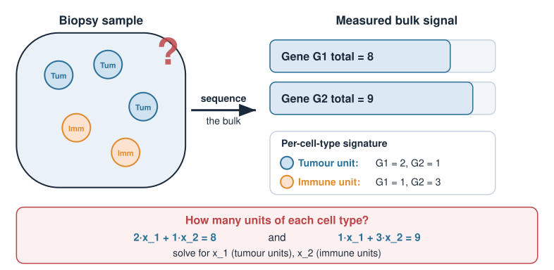
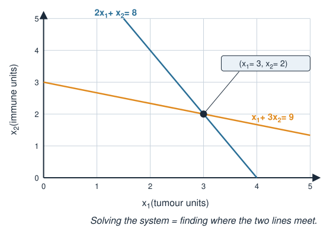
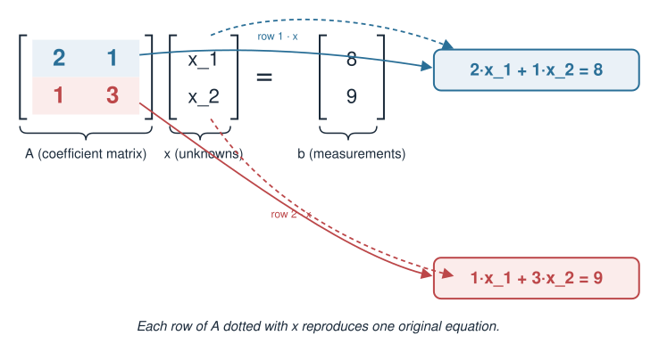
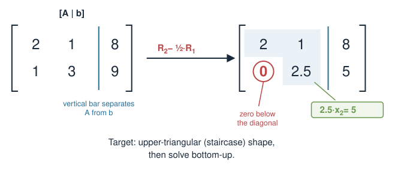

## About this lecture

Today we start the linear-algebra block. By the end you will be able to:

- Recognise when a biology problem is a **system of linear equations**.
- Write such a system in the standard form $A\mathbf{x} = \mathbf{b}$.
- Solve small $2\times 2$ and $3\times 3$ systems **by hand** using
  **substitution** and **Gaussian elimination**.
- **Check** a candidate solution by plugging it back in.

No prior linear algebra is assumed. We build the ideas from a concrete
example and keep all numbers small enough to do with pen and paper.

::: notes
Welcome to the linear-algebra block. This is the foundation for
everything that follows — eigenvalues, Markov chains, PCA — so we go slowly.
Today is deliberately by-hand and concept-heavy: the exam is written and
on-campus, so you need to be able to solve a small system without a computer.
In Linear systems in R we do the same thing at scale.
:::

## A biology problem: what is in the mixture?

A tumour biopsy is **not** one cell type. It is a *mixture*: some tumour
cells, some immune cells, some healthy tissue. Suppose we already know two
**marker readouts** per cell type (say, expression of gene G1 and gene G2),
measured per "unit" of each cell type:

| | Tumour | Immune |
|--|:--:|:--:|
| Gene G1 signal | 2 | 1 |
| Gene G2 signal | 1 | 3 |

We sequence a bulk sample and measure **total** signal: G1 $= 8$, G2 $= 9$.

**Question:** how many units of tumour ($x_1$) and immune ($x_2$) cells were
in the sample?

{width="65%" fig-align="center"}

::: notes
This is the motivating pairing for this unit and Linear systems in R: cell-type
deconvolution. A bulk measurement is a sum over the cell types present. If we
know the per-cell-type signature, recovering the amounts is exactly solving a
linear system. Keep the numbers tiny here on purpose — we will make them
realistic in Linear systems in R.
:::

## Turning the biology into equations

Each measured signal is the sum of contributions from each cell type:

$$
\begin{aligned}
\underbrace{2x_1 + 1x_2}_{\text{total G1}} &= 8\\[2pt]
\underbrace{1x_1 + 3x_2}_{\text{total G2}} &= 9
\end{aligned}
$$

Two unknowns ($x_1, x_2$), two equations. This is a **system of linear
equations**.

"Linear" means every unknown appears only to the first power — no $x_1^2$,
no $x_1 x_2$, no $\sin x_1$. Just numbers times unknowns, added up.

{width="55%" fig-align="center"}

::: notes
Stress what "linear" rules out: no squares, no products of unknowns, no
nonlinear functions. Each equation is a weighted sum of the unknowns set equal
to a number. Almost every method in this course reduces, at its core, to
solving or approximately solving a system like this.
:::

## The standard form $A\mathbf{x} = \mathbf{b}$ {.smaller}

We separate the **known coefficients** from the **unknowns** and the
**measurements**:

$$
\underbrace{\begin{bmatrix} 2 & 1 \\ 1 & 3 \end{bmatrix}}_{A}
\underbrace{\begin{bmatrix} x_1 \\ x_2 \end{bmatrix}}_{\mathbf{x}}
=
\underbrace{\begin{bmatrix} 8 \\ 9 \end{bmatrix}}_{\mathbf{b}}
$$

- $A$ — the **coefficient matrix**. Here, the cell-type signatures (one
  column per cell type, one row per gene).
- $\mathbf{x}$ — the **unknowns** we want (the cell-type amounts).
- $\mathbf{b}$ — the **right-hand side**, our measurements.

The first row of $A$ times $\mathbf{x}$ reproduces the first equation; the
second row gives the second. This packaging is what lets us scale to hundreds
of genes later.

{width="60%" fig-align="center"}

::: notes
Introduce the names carefully: coefficient matrix A, unknown vector x,
right-hand side b. Notation conventions for the course: uppercase for
matrices, bold lowercase for vectors. Walk through how "row of A times x"
rebuilds each equation — this is the first glimpse of matrix-vector
multiplication, which we formalise in Matrices as transformations.
:::

## Strategy 1 — Substitution

Solve one equation for one unknown, then substitute into the other.

From equation 1: $\;2x_1 + x_2 = 8 \;\Rightarrow\; x_2 = 8 - 2x_1$.

Put that into equation 2:

$$
x_1 + 3(8 - 2x_1) = 9 \;\Rightarrow\; x_1 + 24 - 6x_1 = 9 \;\Rightarrow\; -5x_1 = -15
$$

So $x_1 = 3$, and then $x_2 = 8 - 2(3) = 2$.

**Answer:** 3 units of tumour, 2 units of immune cells.

::: notes
Substitution is the method most students already half-remember from school.
Do it slowly. Isolate one variable, push it into the other equation, you now
have one equation in one unknown. Solve, then back-substitute. The arithmetic
is the only place to slip up, so go step by step on the board.
:::

## Always check your answer

Plug $x_1 = 3,\; x_2 = 2$ back into the **original** equations:

$$
\begin{aligned}
2(3) + 1(2) &= 6 + 2 = 8 \quad\checkmark\\
1(3) + 3(2) &= 3 + 6 = 9 \quad\checkmark
\end{aligned}
$$

Both hold, so the solution is correct.

Checking costs seconds and catches almost every arithmetic mistake. On the
exam, **always** do it.

::: notes
Make checking a habit and say so explicitly. Substituting back into the
original equations is independent of how you got the answer, so it catches
sign errors and arithmetic slips. This is free marks on an exam and free
peace of mind in real analysis.
:::

## Strategy 2 — Gaussian elimination

Substitution gets messy with three or more unknowns. **Gaussian elimination**
is the systematic method that scales (it is what R uses internally).

The idea: add multiples of one equation to another to **eliminate** a
variable, until the system is easy to read off.

Two moves are allowed (they never change the solution):

1. Multiply an equation by a non-zero number.
2. Add a multiple of one equation to another.

(A third, swapping two equations, just reorders them.)

::: notes
Frame Gaussian elimination as "substitution made systematic". The allowed
operations are the row operations; emphasise that each one preserves the
solution set, which is why we are allowed to do them. This is the algorithm
behind solve() in R, so understanding it by hand demystifies the computer.
:::

## Gaussian elimination on our 2×2 {.smaller}

Start:

$$
\begin{aligned}
2x_1 + 1x_2 &= 8 \quad(\text{R1})\\
1x_1 + 3x_2 &= 9 \quad(\text{R2})
\end{aligned}
$$

Eliminate $x_1$ from R2. Replace R2 by $\;\text{R2} - \tfrac{1}{2}\text{R1}$:

$$
\Big(1 - \tfrac{1}{2}\cdot 2\Big)x_1 + \Big(3 - \tfrac{1}{2}\cdot 1\Big)x_2
= 9 - \tfrac{1}{2}\cdot 8
\;\Rightarrow\; 0\,x_1 + 2.5\,x_2 = 5
$$

Now R2 says $2.5\,x_2 = 5 \Rightarrow x_2 = 2$. **Back-substitute** into R1:
$2x_1 + 2 = 8 \Rightarrow x_1 = 3$. Same answer as before. $\checkmark$

::: notes
Show the multiplier choice: we want to kill x1 in R2, R2 has coefficient 1 and
R1 has coefficient 2, so subtract half of R1. The x1 term vanishes by design.
Then the last equation has a single unknown — solve it, then back-substitute
upward. Reassure them it gives the same answer as substitution; it is the same
maths, organised.
:::

## Try it: two equations, two lines

Each equation is a line; a solution lies on both. Lines **cross** (one solution), are **parallel** (none: elimination gives $0 = c \neq 0$) or are **the same line** (infinitely many: $0 = 0$).

```{=html}
<link rel="stylesheet" href="../demos/dist/demo.css">
<div data-demo="twolines" data-eq1="2 1 8" data-eq2="1 3 9"></div>
<script src="../demos/dist/twolines.js"></script>
```

::: notes
Live demo. Start on our mixture, 2x1 + x2 = 8 and x1 + 3x2 = 9: the lines cross at (3, 2), and the grey box shows the same elimination step as the previous slide, R2 − ½R1 gives 2.5x2 = 5. Then the three cases. Click "parallel": same left side, different right side; the step now wipes out x2 as well and leaves 0 = −4, which no (x1, x2) satisfies. Click "same line": 2x1 + 4x2 = 6 is just twice x1 + 2x2 = 3, so the step leaves 0 = 0 and x2 is free. Ask the room: can two lines meet in exactly two points? No, so a linear system has one, none or infinitely many solutions, never two. Then "nearly parallel": the crossing sits at (−3, 5); drag c2 up by half a step and it jumps off the plot to (−8, 10). Biology: two cell types with almost the same signature, where a little measurement noise moves the estimated amounts a lot. Linear systems in R returns to these cases with solve() errors and rank. Handles: the open circle shifts a line, the filled one turns it.
:::

## The augmented matrix shorthand {.smaller}

We do not need to keep writing $x_1, x_2$. Track only the numbers in an
**augmented matrix** $[\,A \mid \mathbf{b}\,]$:

$$
\left[\begin{array}{cc|c} 2 & 1 & 8 \\ 1 & 3 & 9 \end{array}\right]
\xrightarrow{\;\text{R2}\,-\,\frac12\text{R1}\;}
\left[\begin{array}{cc|c} 2 & 1 & 8 \\ 0 & 2.5 & 5 \end{array}\right]
$$

The bottom row reads $2.5\,x_2 = 5$. The goal is this **upper-triangular**
("staircase") shape: zeros below the diagonal. Then solve bottom-up.

{width="65%" fig-align="center"}

::: notes
The augmented matrix is bookkeeping: a vertical bar separates A from b, and we
apply the same row operations to the whole row including the b entry. Target
shape is upper triangular — once you are there, the last row is one equation in
one unknown and you climb back up. This notation is essential for the 3x3 case.
:::

## Scaling up: a 3×3 system {.smaller}

Three cell types (tumour, immune, stroma), three marker genes. Signatures and
measurements give:

$$
\begin{aligned}
1x_1 + 1x_2 + 1x_3 &= 6\\
0x_1 + 2x_2 + 1x_3 &= 7\\
2x_1 + 1x_2 + 1x_3 &= 8
\end{aligned}
\qquad
\left[\begin{array}{ccc|c}
1 & 1 & 1 & 6\\
0 & 2 & 1 & 7\\
2 & 1 & 1 & 8
\end{array}\right]
$$

We eliminate column by column, top-left to bottom-right.

::: notes
Now the payoff for systematic elimination. With three unknowns substitution
becomes error-prone, but elimination is just "clear column 1, then clear column
2". The first equation conveniently already has a 1 in the top-left, our pivot.
Walk through the plan before doing the arithmetic.
:::

## 3×3 elimination — clear column 1 {.smaller}

Pivot is the $1$ in the top-left. R2 already has a $0$ there. Clear R3 with
$\;\text{R3} - 2\,\text{R1}$:

$$
\left[\begin{array}{ccc|c}
1 & 1 & 1 & 6\\
0 & 2 & 1 & 7\\
2 & 1 & 1 & 8
\end{array}\right]
\xrightarrow{\;\text{R3}-2\text{R1}\;}
\left[\begin{array}{ccc|c}
1 & 1 & 1 & 6\\
0 & 2 & 1 & 7\\
0 & -1 & -1 & -4
\end{array}\right]
$$

Column 1 now has zeros below the pivot.

::: notes
R3 minus two times R1: 2 minus 2 is 0, 1 minus 2 is minus 1, 1 minus 2 is
minus 1, and 8 minus 12 is minus 4. Do each subtraction out loud. The point is
that the first unknown is now confined to the first equation only.
:::

## 3×3 elimination — clear column 2 {.smaller}

Pivot is now the $2$ in R2. Clear R3 with
$\;\text{R3} + \tfrac{1}{2}\text{R2}$:

$$
\left[\begin{array}{ccc|c}
1 & 1 & 1 & 6\\
0 & 2 & 1 & 7\\
0 & -1 & -1 & -4
\end{array}\right]
\xrightarrow{\;\text{R3}+\frac12\text{R2}\;}
\left[\begin{array}{ccc|c}
1 & 1 & 1 & 6\\
0 & 2 & 1 & 7\\
0 & 0 & -0.5 & -0.5
\end{array}\right]
$$

Now upper-triangular. The bottom row reads $-0.5\,x_3 = -0.5$.

::: notes
R2 has minus 1 in column 2 below the pivot 2, so add half of R2 to R3 to kill
it. Minus 1 plus 1 is 0; minus 1 plus a half is minus a half; minus 4 plus 3.5
is minus a half. We have reached the staircase shape. Now we read off and back-
substitute.
:::

## 3×3 — back-substitution {.smaller}

From the bottom up:

$$
\begin{aligned}
-0.5\,x_3 &= -0.5 &&\Rightarrow\; x_3 = 1\\
2x_2 + x_3 &= 7 &&\Rightarrow\; 2x_2 + 1 = 7 \;\Rightarrow\; x_2 = 3\\
x_1 + x_2 + x_3 &= 6 &&\Rightarrow\; x_1 + 3 + 1 = 6 \;\Rightarrow\; x_1 = 2
\end{aligned}
$$

**Solution:** $x_1 = 2,\; x_2 = 3,\; x_3 = 1$.

**Check** in the original: $2+3+1=6\,\checkmark$, $0+6+1=7\,\checkmark$,
$4+3+1=8\,\checkmark$.

::: notes
Back-substitution always starts at the last row, which has one unknown. Solve
it, carry that value up into the second-last row which now has one remaining
unknown, and so on. Then check all three original equations. This is the full
recipe they need for the exam.
:::

## The inverse: one matrix that undoes $A$

The **inverse** $A^{-1}$ is the matrix with $A^{-1}A = I$. Once you have it, every system with this $A$ is one multiplication:

$$A\mathbf{x} = \mathbf{b} \quad\Rightarrow\quad \mathbf{x} = A^{-1}\mathbf{b}$$

Why bother? In deconvolution the signatures $A$ stay the same and only the measurements $\mathbf{b}$ change from sample to sample. Invert once, reuse for every sample.

**How:** put the identity on the right, $[\,A \mid I\,]$, and keep doing row operations until the **left** side is $I$. Then the right side is $A^{-1}$:

$$[\,A \mid I\,] \;\longrightarrow\; \cdots \;\longrightarrow\; [\,I \mid A^{-1}\,]$$

- Same row operations as before, applied to the whole row.
- New: after reaching the staircase, also eliminate **upwards**, then divide each row by its diagonal number. (This is called Gauss–Jordan elimination.)

::: notes
The augmented matrix [A | b] solved for one right-hand side. [A | I] solves for the two columns of I at the same time: the first column of the result solves A x = (1, 0), the second solves A x = (0, 1), and together those columns are A^{-1}. So nothing new is being invented: it is elimination with two right-hand sides at once, carried all the way to I instead of stopping at the staircase. No determinants needed.
:::

## Inverse by hand: our 2×2

$A = \begin{pmatrix} 2 & 1 \\ 1 & 3 \end{pmatrix}$ from before. Clear below the diagonal, then above it, then scale:

$$
\left[\begin{array}{cc|cc} 2 & 1 & 1 & 0 \\ 1 & 3 & 0 & 1 \end{array}\right]
\xrightarrow{\;\text{R2}\,-\,\frac12\text{R1}\;}
\left[\begin{array}{cc|cc} 2 & 1 & 1 & 0 \\ 0 & 2.5 & -0.5 & 1 \end{array}\right]
\xrightarrow{\;\text{R2}\,\div\,2.5\;}
\left[\begin{array}{cc|cc} 2 & 1 & 1 & 0 \\ 0 & 1 & -0.2 & 0.4 \end{array}\right]
$$

$$
\xrightarrow{\;\text{R1}\,-\,\text{R2}\;}
\left[\begin{array}{cc|cc} 2 & 0 & 1.2 & -0.4 \\ 0 & 1 & -0.2 & 0.4 \end{array}\right]
\xrightarrow{\;\text{R1}\,\div\,2\;}
\left[\begin{array}{cc|cc} 1 & 0 & 0.6 & -0.2 \\ 0 & 1 & -0.2 & 0.4 \end{array}\right]
$$

So $A^{-1} = \begin{pmatrix} 0.6 & -0.2 \\ -0.2 & 0.4 \end{pmatrix}$. **Check:** $A^{-1}\mathbf{b} = \begin{pmatrix} 0.6\cdot 8 - 0.2\cdot 9 \\ -0.2\cdot 8 + 0.4\cdot 9 \end{pmatrix} = \begin{pmatrix} 3 \\ 2 \end{pmatrix}$, the same answer as before. $\checkmark$

**No inverse?** If elimination leaves a row of **zeros on the left**, you can never reach $I$: the matrix is **singular** (its columns point along the same line) and has no inverse.

::: notes
Walk the four steps slowly: the first is exactly the elimination step from before, the second makes the pivot 1, the third clears the entry above the pivot, the fourth scales row 1. Every operation is applied to all four numbers in the row. Two checks students can always do: multiply A^{-1} b and compare with the earlier answer, or multiply A %*% A^{-1} and get I. The singular case connects to Linear systems in R: a zero row on the left is the same situation as "no unique solution". (The ad - bc formula for 2x2 inverses is a bonus shortcut, not needed for the exam.)
:::

## The same idea in R (preview) {.smaller}

In Linear systems in R we let the computer do the elimination. The code is short:

```r
A <- matrix(c(1, 1, 1,
              0, 2, 1,
              2, 1, 1), nrow = 3, byrow = TRUE)
b <- c(6, 7, 8)
solve(A, b)
# [1] 2 3 1
solve(A)       # one argument: the inverse
```

`solve()` runs Gaussian elimination internally — exactly what you just did by
hand, but on any size. With one argument it returns $A^{-1}$.

::: notes
A quick reassurance and a hook into Linear systems in R. We will not type matrices by hand
forever; solve does the elimination for us. But knowing what it does is what
lets you trust it, debug it, and answer exam questions where no computer is
allowed. Note byrow = TRUE so the matrix reads like the page.
:::

## Summary

- A **linear system** = weighted sums of unknowns set equal to numbers.
- Standard form: $A\mathbf{x} = \mathbf{b}$ ($A$ coefficients, $\mathbf{x}$
  unknowns, $\mathbf{b}$ measurements).
- **Substitution** for tiny systems; **Gaussian elimination** (via the
  augmented matrix) for anything bigger — eliminate to upper-triangular, then
  back-substitute.
- **Inverse:** row-reduce $[\,A \mid I\,]$ to $[\,I \mid A^{-1}\,]$; then $\mathbf{x} = A^{-1}\mathbf{b}$
  for any $\mathbf{b}$. A zero row on the left means no inverse.
- **Always check** by substituting back into the original equations.
- Biology hook: recovering cell-type amounts from bulk measurements.

**Next:** Linear systems in R — what happens when there is *no* solution
or *infinitely many*.

::: notes
Recap the four takeaways and the biology framing. Flag the open question for
Linear systems in R: so far every system has had exactly one answer, but that is not
guaranteed — sometimes there is none, sometimes infinitely many, and that maps
directly onto whether a deconvolution problem is well posed. Point them to the
exercise and quiz.
:::
