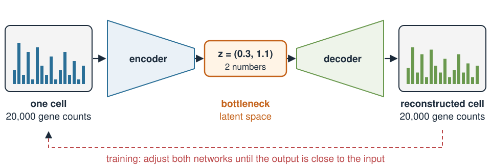
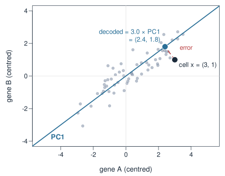
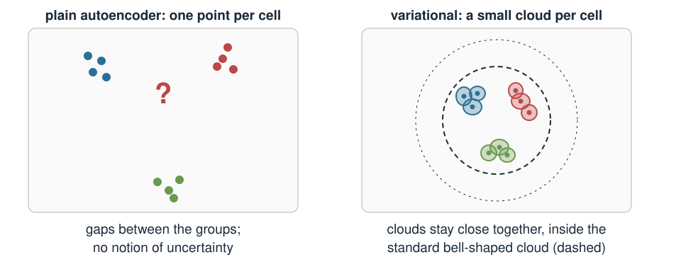
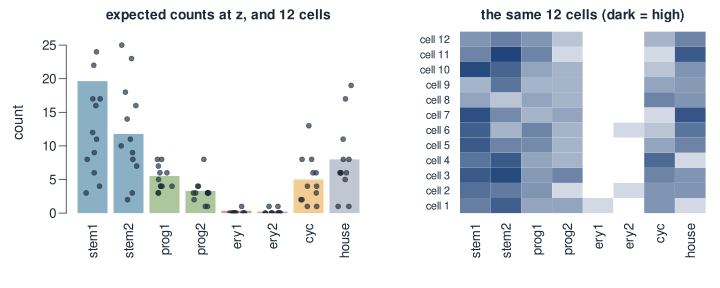
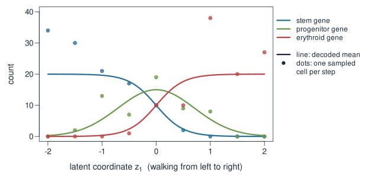
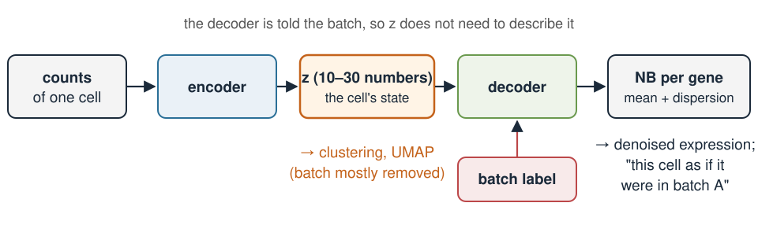

## About this lecture

PCA and UMAP gave every cell a few coordinates in a **latent space**. This lecture is about a method that also goes the **other way**: from a few coordinates back to a whole cell.

- An **autoencoder** = an **encoder** (cell → a few numbers) and a **decoder** (a few numbers → cell).
- **PCA is the simplest autoencoder.** A neural network allows curved maps instead of straight ones.
- **Variational**: each cell becomes a small **cloud** in latent space, not a point.
- The decoder gives a **distribution** of counts (negative binomial), so it can **generate** new cells.
- **One latent point → many different cells**, just as replicate cells of the same state differ.

Pictures and intuition only: no training maths.

::: notes
This is extra material and deliberately non-technical. Students know PCA (scores and loadings), UMAP, the negative binomial from Error models, and the words prior and posterior from the Bayesian block. Everything today is built from those pieces. The one new ingredient is a neural network, which we treat as "a flexible curved function with many knobs that a computer tunes". We never write down the training objective; one sentence in words is enough. The demo carries the main message: one latent point gives many cells.
:::

## Many genes, few real knobs

A cell is measured on **~20,000 genes**, but its expression is not 20,000 independent choices.

- What really varies between cells is a **handful of factors**: cell type, position along a differentiation path, cell-cycle phase, stress, …
- Genes respond to these factors **together**: a T cell switches on dozens of T-cell genes at once.
- So the cells lie close to a **low-dimensional** shape inside gene space.

We have seen this already:

| Method | Cell → few numbers | Few numbers → cell |
|---|---|---|
| PCA | scores (projection on the PCs) | scores × loadings |
| UMAP | 2D layout | **no way back** |
| Autoencoder | **encoder** | **decoder** |

::: notes
Start from biology. The number of genes is huge, but the number of things a cell can "decide" is small. That is why PCA works at all: 30 PCs capture most of the structured variation in a scRNA-seq dataset. The table is the map of today. PCA can go both ways: scores summarise a cell, and scores times loadings rebuild an approximation of it. UMAP only goes one way: there is no formula that turns a UMAP position into an expression profile. An autoencoder has both directions as explicit, learned functions, and they may be curved.
:::

## The autoencoder: squeeze, then rebuild {.smaller}

{width="92%" fig-align="center"}

- The **encoder** compresses a cell into a few numbers $z$, its position in latent space.
- The **decoder** rebuilds the whole expression profile from $z$ alone.
- Training adjusts both until the **output is close to the input**, for thousands of cells.
- The narrow **bottleneck** is the point: to rebuild 20,000 genes from 2 numbers, those 2 numbers must capture what matters most about the cell.

::: notes
The hourglass is the one picture to remember. If the bottleneck were as wide as the input, the network could just copy the cell through and learn nothing. Squeezing through two numbers forces it to find the main axes of variation, as PCA does. "Training" here means: start with random knobs, measure how badly the output matches the input, nudge all knobs to do a bit better, repeat many times. Students do not need to know how the nudging works.
:::

## PCA is a linear autoencoder {.smaller}

:::: {.columns}
::: {.column width="52%"}
{width="100%"}
:::
::: {.column width="48%"}
Two genes, one number (PC1, $\mathbf{u} = (0.8, 0.6)$):

- **Encode**: the score $= \mathbf{x}\cdot\mathbf{u} = 0.8\cdot 3 + 0.6\cdot 1 = 3.0$.
- **Decode**: score $\times\ \mathbf{u} = 3.0\cdot(0.8, 0.6) = (2.4, 1.8)$.
- **Error**: $(3, 1) - (2.4, 1.8) = (0.6, -0.8)$, squared length $1.0$.

Of all **straight-line** encoders and decoders, PCA gives the smallest total reconstruction error.

A neural network replaces both straight maps by **curved** ones: same hourglass, more flexible.
:::
::::

::: notes
This is the key bridge. Everything on this slide is from Principal component analysis: the score is the dot product with the unit PC, and multiplying the score back by the PC gives the point on the PC line. The red dashed segment is what is lost by keeping one number instead of two. For centred data, keeping k PCs gives the smallest possible squared error among all linear encode/decode pairs with k numbers; a linear autoencoder trained to minimise squared error ends up spanning the same subspace as the PCs. So an autoencoder is "PCA with curved maps". The exercise works through this example and computes reconstruction error against the number of PCs in R.
:::

## Why curved maps help

A differentiation path is a **curve** in gene space: stem genes fade, progenitor genes rise and fall, erythroid genes switch on.

- PCA needs **two** axes to hold this one curve, and draws it as a horseshoe (exercise, R part).
- A decoder with curved maps can lay the path along **one** latent direction and bend it back into gene space.
- The same idea as the "linear flattens the manifold" problem from Dimensionality reduction & clustering, now with a way back to genes.

A neural network is just a **flexible function with many knobs** (weights). Here it is small: one hidden layer of 32 units.

::: notes
Point back to the UMAP lecture: PCA is linear, so curved structures get flattened or need extra dimensions. UMAP solves the visualisation part but cannot rebuild a cell. A decoder network can do both: put cells on a low-dimensional latent space and map back. Do not go into neurons, activations or back-propagation; "a curved function with many adjustable numbers" is the right level. The trained model in the demo has 32 hidden units in each network, about 2,600 numbers in total; scVI uses larger networks.
:::

## What a plain autoencoder lacks {.smaller}

{width="78%" fig-align="center"}

A plain autoencoder places each training cell at **one point**. Nothing says what the decoder should do **between** the points:

- A point in a gap may decode to something that looks like no real cell.
- There is no notion of **how sure** we are about a cell's position.
- So we cannot simply pick a point and **generate** a believable new cell.

::: notes
The left panel is the problem. The decoder was only ever asked to rebuild the training cells, so it was only tested at those points; in the gaps it can do anything. And the position of a cell is a single number pair, with no error bar, even though a cell with 500 counts is far less certain than one with 20,000. The right panel is the fix on the next slide.
:::

## "Variational": a cloud instead of a point

The encoder outputs a **centre** and a **spread** for every cell: a small cloud of likely positions.

- During training, the decoder must rebuild the cell from **random points inside its cloud**, so every point near the cell has to decode to something like it.
- A **penalty** keeps every cloud close to one standard bell-shaped cloud around 0, so the clouds stay close together and fill the space with few gaps.
- The spread is a statement of **uncertainty**: few counts → wide cloud.

In Bayesian words: the standard bell-shaped cloud is the **prior** for $z$, and the cell's cloud is an approximate **posterior** for where that cell sits in latent space. "Variational" names the method that finds these approximations.

::: notes
This is the whole difference between an autoencoder and a variational autoencoder, in words. Two forces act during training: rebuild the cell well (which pulls clouds apart and makes them small), and stay close to the standard cloud (which pulls them together and makes them wide). The balance gives a tidy latent space in which a point between two groups decodes to something reasonable, often an in-between profile. The link to the Bayesian block is a single sentence: prior on z, approximate posterior per cell. We do not write the penalty; it is a KL divergence, if a student asks, and the method was introduced by Kingma and Welling (2014). Reference: D. P. Kingma, M. Welling (2014), Auto-Encoding Variational Bayes, ICLR 2014, arXiv:1312.6114.
:::

## The decoder outputs a distribution

For counts, the decoder does not output one cell. For every gene it outputs the parameters of a **count distribution**:

$$\text{gene } g \text{ in a cell at } z: \qquad \text{count} \sim \text{NB}\big(\text{mean} = \mu_g(z),\ \text{dispersion } \phi_g\big)$$

- The **mean** $\mu_g(z)$ changes with the position $z$: this is the biology.
- The **spread** around it is the overdispersed counting noise of Error models: $\text{Var} = \mu + \phi\mu^2$.
- Training asks: how **probable** are the observed counts under this NB? (A likelihood, as in Bayesian statistics.)

This is what **scVI** does for single-cell RNA-seq (Lopez et al. 2018).

::: notes
Connect to Error models: the negative binomial with mean mu and dispersion phi, variance mu plus phi mu squared, is exactly the error model DESeq2 and edgeR use. Here the mean of every gene is not a fixed number but a function of the cell's latent position. So the decoder separates two kinds of variation: biological (where the cell is in latent space) and technical/counting (the NB spread around the mean). The demo VAE was trained with an NB likelihood and a learned dispersion per gene. scVI also includes the library size of each cell, which we left out by giving all simulated cells the same depth. Reference: R. Lopez, J. Regier, M. B. Cole, M. I. Jordan, N. Yosef (2018), Deep generative modeling for single-cell transcriptomics, Nature Methods 15, 1053–1058.
:::

## Generating cells: one $z$, many cells {.smaller}

To **generate** a cell: pick a point $z$ → decode to expected counts → **draw** counts from the NB.

{width="88%" fig-align="center"}

The **same** $z$ gives **different** cells every time. They differ only by sampling noise, as real cells in the **same state** do.

::: notes
This is the main message of the lecture. The bars are the decoder's expected counts at one latent point (here from the hand-written decoder of the exercise, at z1 = −1: a stem-like cell). The dots and the heatmap rows are 12 cells drawn from the negative binomial around those means. Stem1 has mean 19.6 but the 12 cells range from 3 to 24. That spread is not a failure of the model; it is the model saying that cells in this state really do vary that much in their counts. Ask: if you sequenced 12 cells that are biologically identical, would you expect identical counts? No: Error models said counts are overdispersed. A generative model reproduces that.
:::

## A walk through latent space {.smaller}

Different $z$ → different cell states. Moving $z$ along a line gives a **smooth transition**:

{width="82%" fig-align="center"}

The midpoint is **not** the average of the two end profiles: the progenitor gene peaks at $z_1 = 0$ (mean 15) but is only 5.5 at both ends. The decoder bends the path through gene space.

::: notes
The lines are decoded means along a straight walk from z1 = −2 to z1 = 2; the dots are one sampled cell per step, which wobble around the lines. A straight line in latent space is a curve in gene space. Averaging the two endpoint profiles would give a progenitor value of 5.5; decoding the latent midpoint gives 15. This is the nonlinear part: the transient programme appears only through the decoder. In real data this is how VAEs are used to explore trajectories or to ask "what lies between these two cell states?". With a trained model, how believable the in-between profiles are depends on whether real cells lived there.
:::

## Try it: one $z$, many cells

```{=html}
<link rel="stylesheet" href="../demos/dist/demo.css">
<div data-demo="vaegen" data-tabs="cells"></div>
<script src="../demos/dist/vaegen.js"></script>
```

::: notes
This is a real, small VAE, trained offline (plain JavaScript, fixed seed; the script is demos/src/vaegen/train.ts) on 1500 simulated cells × 36 genes: T cells, B cells, and a stem → progenitor → erythroid trajectory, with negative-binomial counts. Encoder and decoder have 32 hidden units each, the latent space has 2 dimensions, and the likelihood is negative binomial with a learned dispersion per gene. The faint dots are the encoder centres of the training cells. Drag z: the bars are the decoder's expected counts; the dots and rows are 8 cells drawn from the same z. Press "Sample again": the bars stay, the cells change. Set dispersion to 0 (Poisson) and the cells get more alike; at 3 they spread out. "between T and B" decodes to weak T and B genes together, a profile few real cells have. "far outside" decodes to stem and progenitor genes both high, higher than any training cell shows together: the decoder extrapolates, and nothing guarantees the result is biology. Walk mode: "stem → erythroid" shows the transition. Encode a cell: click any dot to see its cloud (±2 sd) and its reconstruction. Checks on this model: reconstruction error is about half that of a "same average cell for everyone" baseline (NB negative log-likelihood 52 vs 109 per cell) and much lower than PCA with 2 components on log counts; a 15-nearest-neighbour vote in the 2D latent space recovers the T/B/trajectory group of 100% of cells.
:::

## Try it: digits

```{=html}
<link rel="stylesheet" href="../demos/dist/demo.css">
<div data-demo="vaegen" data-tabs="digits"></div>
<script src="../demos/dist/vaegen.js"></script>
```

::: notes
The same idea on images, where encoding and decoding are easy to see: a VAE with a 2D latent space trained on MNIST handwritten digits (60,000 images of 28 × 28 pixels; Y. LeCun, C. Cortes and C. J. C. Burges; the Keras documentation states the copyright holders as LeCun and Cortes and the licence as CC BY-SA 3.0). Trained offline with torch (demos/src/vaegen/train_mnist.py), weights stored as 8-bit integers. Draw a digit, press Encode: the cross is the cloud centre and the small orange ellipse its spread; the big image is the reconstruction. Tick "decoded grid" to see the classic map: every region decodes to a digit and they morph into each other. "walk 1 → 7" shows a smooth morph. Images and counts differ in one way: for images the variation lives almost entirely in z (the decoder outputs a smooth picture and the cloud is tiny), while for counts a second source of variation sits in the sampling step, the NB noise around the decoded mean. Some digits overlap in 2D (4 and 9, 3/5/8): two numbers are too few to keep ten classes apart, and a 15-nearest-neighbour vote recovers the digit of 72% of test images.
:::

## Uses in single-cell analysis {.smaller}

{width="80%" fig-align="center"}

- **scVI**: the latent $z$ is used for clustering and UMAP instead of PCA. Telling the decoder the **batch** lets $z$ ignore batch differences (batch correction), and decoded means give **denoised** expression.
- **Several modalities** in one latent space: totalVI for RNA + surface proteins (Gayoso et al. 2021), MultiVI for RNA + chromatin accessibility (Ashuach et al. 2023). Compare the joint latent space of Multiome data integration.
- **Generating or imputing**: decode $z$ to fill in missing values or simulate cells.

::: notes
Keep this brief. The batch trick is the most used feature: if the decoder already knows which batch a cell came from, the latent space does not need to encode batch, so cells from different batches but the same type land in the same place. Decoding a cell's z with a different batch label gives "this cell as if measured in batch A". totalVI and MultiVI give each modality its own decoder and its own error model, all reading from one shared z: the same joint-latent-space idea as in the Multiome unit, but nonlinear. All three are in the scvi-tools Python package. References: A. Gayoso et al. (2021), Joint probabilistic modeling of single-cell multi-omic data with totalVI, Nature Methods 18, 272–282. T. Ashuach et al. (2023), MultiVI: deep generative model for the integration of multimodal data, Nature Methods 20, 1222–1231.
:::

## Caveats: do not over-interpret

- **Latent axes have no fixed meaning.** Unlike PCA loadings, $z_1$ and $z_2$ are not ranked or interpretable by construction; a rotated or flipped latent space can fit about as well.
- **Results depend on training**: random starting values, network size and training length all change the latent space. Retrain with another seed and the picture moves.
- **Generated cells are only as good as the training data.** Far from the data, the decoder extrapolates; between groups it interpolates. Neither is guaranteed to be biology.
- **Distances in latent space** are not calibrated; the same reading rules as for a UMAP apply.
- **Uncertainty is approximate**: the clouds are a convenient shape, not the exact posterior.

::: notes
Same spirit as the caveats in Dimensionality reduction & clustering. The most common mistake is to read a decoded profile at an arbitrary latent point as a prediction of a real cell state. A decoded profile is a smooth guess based on nearby training cells; far from the data there are none. The second mistake is to name latent axes as if they were PCs: a VAE has no ordering of axes by variance, and the penalty is symmetric under rotation. Validate claims with marker genes and independent data, as with clusters.
:::

## Summary {.smaller}

| Idea | In one line |
|---|---|
| Encoder | cell → a few numbers $z$ (its place in latent space) |
| Decoder | $z$ → expected expression of every gene |
| Autoencoder | trained so that decode(encode(cell)) ≈ cell, through a narrow bottleneck |
| PCA | the linear autoencoder: encode = project, decode = score × PC |
| Variational | each cell → a small **cloud**; clouds kept close to a standard bell-shaped cloud |
| Decoder output | a distribution: NB per gene for counts (scVI) |
| Generative | one $z$ → many different cells; a walk in $z$ → a smooth transition |
| Caution | axes not interpretable; far from the data the decoder only guesses |

::: notes
Return to the table from slide 2: PCA, UMAP and autoencoders all put cells in a latent space, but only PCA and autoencoders can go back to genes, and only a variational autoencoder with a count distribution can generate realistic new cells. The exercise does PCA as an autoencoder by hand and in R, reads a small decoder table, and generates cells from one latent point with rnbinom.
:::
